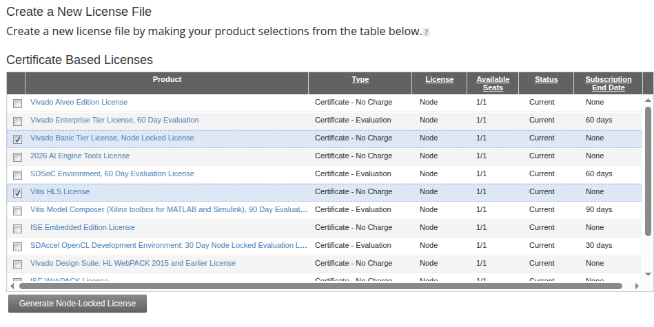

# 2. Vivado 2026.1 licensing

Since 2026.1, a valid license file must be installed and accessible before Vivado launches. For the ZC702's XC7Z020, the free **Basic** tier supports the device family on Linux.

References:

* [AMD Vivado Licensing Options](https://www.amd.com/en/products/software/adaptive-socs-and-fpgas/vivado/vivado-licensing-options.html)
* [AMD Product Licensing Portal](https://account.amd.com/en/forms/license/license-form.html)
* [UG973: Feature Availability by Subscription Tier](https://docs.amd.com/r/en-US/ug973-vivado-release-notes-install-license/Feature-Availability-by-Subscription-Tier)

## 2.1 What Basic gives you

Basic is free and covers all Zynq-7000 devices. HLS needs the separate no-charge Vitis HLS license in addition to Basic, because AMD requires a valid Vivado tier license for Vitis flows that invoke Vivado. It is an annual subscription: the license expires and must be regenerated (free) each year. Replace the copy in the container's persistent home when you renew (see [4.6](04-install-vivado.md#46-copy-the-license-into-the-persistent-home)).

Limits that matter for this lab:

* XSIM simulation is capped at 50K design instances. A small robot controller is far below that.
* ILA is limited to 5 probes of up to 1024 bits each. System ILA and IBERT are not available.
* The `xcrg` coverage report tool is not available.

Basic does not support minor releases such as 2026.1.1. Stay on the original 2026.1 release. Nothing in 2026.1.1 affects the XC7Z020 (it only adds Versal and Spartan UltraScale+ devices).

## 2.2 Generate a node-locked license

Basic is node-locked only, and AMD allows one Basic license per AMD account. The Vitis HLS license is also free and is needed for the HLS flow, so generate both together.

1. Sign in to the AMD Product Licensing Portal and open **Create New Licenses**.
2. In the **Certificate Based Licenses** table, tick only these two rows:
   * **Vivado Basic Tier License, Node Locked License**
   * **Vitis HLS License**
3. Click **Generate Node-Locked License**.
4. When asked for a host, add one with Host ID Type **Ethernet MAC**.



Leave every other row unticked. The rest are evaluation licenses or tools for other devices and older releases (Alveo, AI Engine, SDSoC, SDAccel, Model Composer, ISE, PetaLinux), and none are needed here. If the portal will not let you tick both at once, generate the Basic license first, then the Vitis HLS one for the same host.

The host name is only a label. For the MAC, run this on the host (not in the container):

```bash
ip -br link
```

Use the MAC from a stable physical wired interface, usually named `en...` (for example `enp3s0`). Do not use `lo`, `docker0`, a `veth` interface, or Wi-Fi (`wl...`), since virtual and Wi-Fi MACs can change. The cable does not need to be plugged in. If the portal rejects the colons, enter the MAC without them.

If you move to another computer, change the host ID of the existing license under Manage Licenses instead of creating a second account.

The container uses host networking, but that alone does not guarantee a matching host ID. After installing Vivado, run `vlm` inside the container and open **View Host Information** to confirm the MAC matches the one you licensed.

## 2.3 Store the license

Save it as:

```text
~/installer/Xilinx.lic
```

Use the actual filename from AMD or rename it, keeping the `.lic` extension. If the portal returns two files (one per license), save both in `~/installer` and list both in `XILINXD_LICENSE_FILE`, separated by colons. Never commit them to version control.

The container mounts `~/installer` at `/installer`. The license is copied into the container user's persistent home during [installation](04-install-vivado.md#46-copy-the-license-into-the-persistent-home), and `XILINXD_LICENSE_FILE` points directly to that file.

## 2.4 If you only need to program the board

The standalone **Vivado Lab Edition** (about 1 GB for Linux) programs and debugs devices and needs no license. It is not needed for synthesis or implementation.

Previous: [Host setup](01-host-setup.md) | Next: [Docker environment](03-docker-environment.md)
